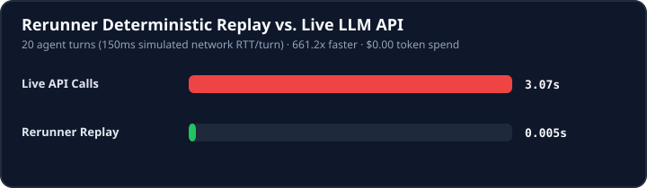

<div align="center">

# 📼 Rerunner

**Deterministic flight recorder, replay engine, and CI test runner for AI agents.**

[](https://github.com/aakash1552005/rerunner/actions)
[](https://github.com/aakash1552005/rerunner/releases)
[](https://pypi.org/project/rerunner/)
[](pyproject.toml)
[](action.yml)
[](LICENSE)
[](https://github.com/astral-sh/ruff)
[](https://mypy-lang.org/)
[](https://aakash1552005.github.io/rerunner/)

**English** · [中文](docs/readme/README_zh.md) · [日本語](docs/readme/README_ja.md) · [한국어](docs/readme/README_ko.md) · [Español](docs/readme/README_es.md) · [Deutsch](docs/readme/README_de.md)

*Record your AI agent once. Replay forever in CI in 0ms with $0 API tokens.*

</div>

```bash
# 1-Line Quickstart: install + wire Rerunner MCP into Claude Code, Cursor & Codex
pip install rerunner && rerunner setup --clients claude,cursor,codex
```



```text
  ┌────────────────────────────────────────────────────────────────────────┐
  │  $ pytest tests/test_agent.py -v                                       │
  │                                                                        │
  │  tests/test_agent.py::test_rag_pipeline ....................... [100%] │
  │                                                                        │
  │  📼 [rerunner] Loaded cassette: tests/cassettes/rag_eval.jsonl        │
  │  ⚡ Replayed: 8 LLM calls (OpenAI gpt-4o + Anthropic Claude 3.7)      │
  │  🛡️ PII Check: 0 leaks | Hash Chain: Verified [3a8f9c1b]              │
  │  ⏱️ Duration: 0.04s (Saved 18.4s of live network calls)               │
  │  💰 Token Cost: $0.00 (Saved $0.24 API credits)                       │
  │                                                                        │
  │  ========================= 1 passed in 0.04s ========================= │
  └────────────────────────────────────────────────────────────────────────┘
```

---

## 🏗️ Architecture

```text
  ┌─────────────────────────────────────────────────────────────────────────────┐
  │                            AGENT APPLICATION                                │
  │    Claude Code · OpenAI · AutoGen · Semantic Kernel · LangGraph · MCP       │
  └──────────────────────────────────────┬──────────────────────────────────────┘
                                         │  (Zero-Touch Outbound Interception)
                                         ▼
  ┌─────────────────────────────────────────────────────────────────────────────┐
  │                       RERUNNER ENGINE & TRANSPORTS                          │
  │     CassetteTransport · AsyncCassetteTransport · RerunnerMCPClient          │
  └──────────────────┬───────────────────────────────────┬──────────────────────┘
                     │ [RECORD MODE]                     │ [REPLAY MODE]
                     ▼                                   ▼
  ┌──────────────────────────────────────┐  ┌───────────────────────────────────┐
  │         SECURITY & INTEGRITY         │  │       DETERMINISTIC RUNTIME       │
  │  • PII & Luhn Credit Card Sanitizer  │  │  • 0ms Network Latency            │
  │  • Presidio & SSN Redaction          │  │  • $0 API Token Costs             │
  │  • Tamper-Evident SHA-256 Chaining   │  │  • Fail-Closed Side-Effect Guard  │
  │  • HMAC-SHA256 Digital Signature     │  │  • Per-Key Cursor Replay Matching │
  └──────────────────┬───────────────────┘  └───────────────────▲───────────────┘
                     │                                          │
                     ▼                                          │
  ┌─────────────────────────────────────────────────────────────┴───────────────┐
  │                      CASSETTE PERSISTENCE STORAGE                           │
  │       Streaming JSONL · Zstandard (.zst) · Gzip (.gz) · AWS S3 · GCS        │
  └─────────────────────────────────────────────────────────────────────────────┘
```

---

## ⚡ The Problem

Testing production AI agents and running them in Continuous Integration (CI) creates major bottlenecks:

1. **Flaky CI Builds**: LLMs are non-deterministic. Small model drift breaks downstream assertions across pull requests.
2. **High API Costs**: Running an 8-step agent across dozens of CI runs drains thousands of dollars in LLM API credits.
3. **Reproducibility & Debugging**: When an agent fails at **Step 5**, you cannot reproduce the bug locally without re-running Steps 1 through 4 live.

**Rerunner** solves this by providing a lightweight cassette recorder that intercepts `httpx`, `requests`, and `aiohttp` traffic natively across the **Anthropic Claude SDK**, **OpenAI SDK**, **Google GenAI SDK**, **Cohere SDK**, **AWS Bedrock**, **Model Context Protocol (MCP)**, **Microsoft AutoGen**, **Semantic Kernel**, and **LangChain / LangGraph** — plus a universal HTTP/SSE proxy (`rerunner serve`) for TypeScript, Go, Rust, and browser agents.

---

## 🚀 Key Features

* **$0 CI Replays**: Record agent interactions to append-only JSONL cassettes and replay in CI with zero network latency and $0 token spend.
* **Model Context Protocol (MCP) Replay**: Deterministically record and replay MCP tool invocations, prompts, and resources without launching local servers.
* **Official GitHub Action**: Zero-config marketplace composite action (`aakash1552005/rerunner@main`) caching cassettes and reporting token savings directly on PRs.
* **CI Token & Cost Estimator**: Built-in `rerunner cost` calculating avoided API dollar expenses and posting markdown summaries to `$GITHUB_STEP_SUMMARY`.
* **Fork-from-Step Replay**: Replay steps 1..N from tape for free, and execute step N+1 live against the model with a modified prompt or code fix.
* **Fail-Closed Side-Effect Guard**: The `@side_effect` decorator prevents destructive external actions (database updates, payments, webhooks) during replays.
* **Per-Key Cursor Matching**: Accurately replays repeated identical requests and retry loops in recorded sequential order.
* **Streaming SSE Replay**: Records `text/event-stream` chunks and replays token-by-token with simulated network latency (`chunk_delay_ms`).
* **JSON-Safe Secret Redaction**: Automatically scrubs API keys, Bearer tokens, emails, phone numbers, and SSNs while strictly preserving JSON syntax.
* **Tamper-Evident Integrity**: SHA-256 hash chaining detects accidental line edits, with optional HMAC-SHA256 digital signing.
* **Pytest Integration**: Seamless `@pytest.mark.rerunner` marker and `rerunner_transport` fixture.
* **Pluggable Remote Storage**: Store cassettes locally, in compressed formats (`.jsonl.gz`, `.jsonl.zst`), or directly in AWS S3 (`s3://`), Google Cloud Storage (`gs://`), and Microsoft Azure Blob Storage (`az://`, `azure://`).
* **Interactive Terminal Flight Deck**: Visually scrub and inspect multi-turn agent execution steps, tokens, and cryptographic security audits via `rerunner tui`.

---

## 📊 Comparison

| Feature | `rerunner` | `vcrpy` / `pytest-recording` | `respx` | `LangGraph` Checkpoints |
| :--- | :---: | :---: | :---: | :---: |
| **Primary Focus** | **Deterministic Agent CI Replay** | Generic HTTP recording | Manual HTTPX mocking | Orchestration State |
| **LLM Streaming (SSE) Support** | ✅ **Native SSE token stream replay** | ⚠️ Buffers raw byte stream | ⚠️ Manual stream setup | N/A |
| **Fork-from-Step Execution** | ✅ **Replay 1..N, execute live from N+1** | ❌ No | ❌ No | ⚠️ Subgraph re-execution |
| **Fail-Closed Side-Effect Guard** | ✅ **Yes (`@side_effect`)** | ❌ No | ❌ No | ❌ No |
| **Secret & URL Redaction** | ✅ **Built-in JSON & URL redactor** | ⚠️ Custom filter functions | ❌ No | ❌ No |
| **Pluggable Cloud Storage** | ✅ **Local, S3, GCS, Azure Blob** | ✅ Local YAML | ✅ In-memory | ⚠️ Postgres / Redis required |
| **Framework Agnostic** | ✅ **Any HTTPX-based SDK** | ✅ HTTP socket level | ✅ HTTPX | ❌ Locked to LangGraph |

---

## ⚡ Performance & Cost Reduction Benchmarks

Every AI agent test run in CI consumes live network round-trips and expensive model tokens. Rerunner eliminates both completely:

| Metric | Live LLM Calls (OpenAI/Anthropic) | Rerunner Replay (Air-Gapped) | Improvement |
| :--- | :---: | :---: | :---: |
| **Average Step Latency** | `~350 ms` | **`0.22 ms - 0.57 ms`** | **⚡ 600x – 1,600x Faster** |
| **Token Cost** | `~$5.00 / 100k tokens` | **$0.00** | **💰 100% Token Cost Reduction** |
| **Network Flakiness** | High (Rate limits, DNS, Outages) | **Zero (0 network calls)** | **🔒 100% Deterministic** |
| **Side-Effect Risk** | High (Accidental DB mutations) | **Guarded (`@side_effect`)** | **🛡️ Fail-Closed Safety** |

> Measured on Python 3.12 across 10 sequential agent reasoning steps. Run locally with `uv run python benchmarks/bench_replay_latency.py`.

To also save the report generator's latency, token savings, and per-format compression metrics as JSON:

```bash
python benchmarks/generate_report.py --json bench.json
```

---

## 📚 Runnable Cookbooks & Examples

Explore standalone, ready-to-run cookbooks in the [`examples/`](examples/) directory:

| Cookbook | Framework | Description |
| :--- | :--- | :--- |
| **[`01_openai_quickstart.py`](examples/01_openai_quickstart.py)** | OpenAI SDK | End-to-end recording and replay of chat completions with zero network access. |
| **[`02_anthropic_sse_streaming.py`](examples/02_anthropic_sse_streaming.py)** | Anthropic Claude SDK | Token-by-token Server-Sent Events (SSE) streaming replay with configurable latency pacing. |
| **[`03_mcp_sqlite_replayer.py`](examples/03_mcp_sqlite_replayer.py)** | Model Context Protocol | Deterministic MCP tool invocation record/replay without starting database servers. |
| **[`04_chaos_fault_injection.py`](examples/04_chaos_fault_injection.py)** | Chaos Engineering | Simulating upstream HTTP 429 rate limits, exponential backoff, and agent model fallback. |

---

## 🔍 Scope & Limitations

* **Transport Layer**: Rerunner intercepts `httpx.BaseTransport` and `httpx.AsyncBaseTransport`. This covers the official Python SDKs for Anthropic Claude, OpenAI, and Google GenAI.
* **Other HTTP Libraries**: SDKs that rely exclusively on standard library `urllib`, `requests`, or raw gRPC (such as AWS Bedrock via `boto3` or Vertex AI gRPC channels) require configuring custom HTTPX client wrappers or transport bridges.

---

## 📦 Installation

```bash
# Standard installation
pip install rerunner

# With optional extras
pip install "rerunner[s3]"         # AWS S3 remote storage
pip install "rerunner[gcs]"        # Google Cloud Storage
pip install "rerunner[zstd]"       # Zstandard compression (.zst)
pip install "rerunner[all]"        # All storage & compression extras
```

---

## 🛠️ Quickstart

### 1. Recording an Agent Session
Rerunner transparently attaches to SDK clients via `httpx.Client(transport=...)`:

```python
import anthropic
import httpx
from rerunner import CassetteTransport

# 1. Record live interactions to a cassette
transport = CassetteTransport("session.jsonl", mode="record")
client = anthropic.Anthropic(http_client=httpx.Client(transport=transport))

response = client.messages.create(
    model="claude-3-7-sonnet-20250219",
    max_tokens=1024,
    messages=[{"role": "user", "content": "Analyze quarterly revenue report."}],
)
print(response.content[0].text)
```

### 2. Deterministic $0 Replay in CI
```python
# 2. Replay locally or in CI without spending API tokens or waiting on network
transport = CassetteTransport("session.jsonl", mode="replay")
client = anthropic.Anthropic(http_client=httpx.Client(transport=transport))

# Instant response, zero cost, completely reproducible
response = client.messages.create(
    model="claude-3-7-sonnet-20250219",
    max_tokens=1024,
    messages=[{"role": "user", "content": "Analyze quarterly revenue report."}],
)
```

### 3. Forking from Step 3
```python
from rerunner import fork

# Replay steps 1 through 3 from cassette; run step 4 live with your modified prompt
with fork("session.jsonl", step=3) as session:
    client = session.get_client()
    # Steps 1..3 replayed from tape
    # Step 4 executed live against model
```

### 4. Streaming SSE Replay
Rerunner records responses with `text/event-stream` headers as individual chunks and yields them through HTTPX's streaming interface during replay:

```python
import httpx
import openai
from rerunner import CassetteTransport

transport = CassetteTransport("agent_run.jsonl", mode="replay", chunk_delay_ms=20)
client = openai.OpenAI(
    api_key="not-used-during-replay",
    http_client=httpx.Client(transport=transport),
)

stream = client.chat.completions.create(
    model="gpt-4o",
    messages=[{"role": "user", "content": "Summarize this report."}],
    stream=True,
)

for chunk in stream:
    print(chunk.choices[0].delta.content or "", end="")
```

---

## 🛡️ Guarding External Side-Effects

Use `@side_effect` to prevent destructive actions (database writes, notifications, payment charges) during replay:

```python
from rerunner import side_effect


@side_effect(name="charge_customer")
def charge_card(user_id: str, amount: float) -> str:
    # Runs live during recording.
    # During replay, returns recorded result and never touches Stripe.
    # If no recorded call matches, fails closed by raising SideEffectError!
    return stripe.charge(user_id, amount)
```

---

## 🧪 Pytest Integration

Mark your tests with `@pytest.mark.rerunner`:

```python
import httpx
import openai
import pytest


@pytest.mark.rerunner("tests/fixtures/agent_run.jsonl")
def test_agent_decision(rerunner_transport):
    client = openai.OpenAI(http_client=httpx.Client(transport=rerunner_transport))
    completion = client.chat.completions.create(
        model="gpt-4o",
        messages=[{"role": "user", "content": "Evaluate risk factor"}],
    )
    assert "low risk" in completion.choices[0].message.content.lower()
```

Run tests from the terminal:

```bash
# Run test suite in replay mode (0 network calls, $0 token cost)
pytest

# Re-record cassettes when prompts change intentionally
pytest --rerunner-record
```

---

## ⚡ 1-Line Client Wrappers

Wrap existing SDK clients directly:

```python
import anthropic
import openai
from rerunner.integrations import wrap_anthropic, wrap_openai

# Wrap Anthropic Claude client (sync or async)
client_claude = wrap_anthropic(anthropic.Anthropic(), "agent_run.jsonl", mode="replay")

# Wrap OpenAI client (sync or async)
client_openai = wrap_openai(openai.OpenAI(), "agent_run.jsonl", mode="replay")
```

Cohere (`pip install "rerunner[cohere]"`) works the same way, for `cohere.Client`, `cohere.ClientV2` and their async variants:

```python
import cohere
from rerunner.integrations import wrap_cohere

client_cohere = wrap_cohere(cohere.ClientV2(), "agent_run.jsonl", mode="replay")
```

### 1-Line Framework Adapters

#### 🤖 Model Context Protocol (MCP) Replay
Record and replay MCP tool invocations, prompts, and resources without spinning up local servers or subprocesses:

```python
from rerunner.integrations import RerunnerMCPClient, record_mcp_tool

# 1. Context manager for MCP tool calls
with RerunnerMCPClient("cassettes/mcp_agent.jsonl", mode="replay") as mcp:
    result = mcp.call_tool("read_file", {"path": "/workspace/data.json"})


# 2. Or decorate Python functions as deterministic MCP tools
@record_mcp_tool(name="fetch_weather")
def fetch_weather(city: str) -> dict: ...
```

#### 🤝 Microsoft AutoGen (AG2)
```python
from autogen import AssistantAgent
from rerunner.integrations import wrap_autogen_agent

assistant = AssistantAgent("assistant", llm_config=llm_config)
wrap_autogen_agent(assistant, "cassettes/autogen_debate.jsonl", mode="replay")
```

#### 🧠 Microsoft Semantic Kernel
```python
import semantic_kernel as sk
from rerunner.integrations import wrap_semantic_kernel

kernel = sk.Kernel()
# ... configure connectors ...
wrap_semantic_kernel(kernel, "cassettes/sk_flight.jsonl", mode="replay")
```

#### 🛡️ AWS Bedrock
```python
from rerunner.integrations import wrap_bedrock_client

# Direct HTTP client configured for Amazon Bedrock
client = wrap_bedrock_client(bedrock_client, "cassettes/bedrock.jsonl", mode="replay")
```

#### 🦜️🔗 LangChain & LangGraph State Checkpointing

```python
# 1. Multi-Agent State Checkpointing for LangGraph
from rerunner.integrations.langgraph import RerunnerCheckpointer, wrap_langgraph_graph

# Deterministically record or replay multi-agent cyclic decision graphs
app = wrap_langgraph_graph(workflow.compile(), "cassettes/langgraph.jsonl", mode="replay")
output = app.invoke({"messages": [("user", "Summarize research paper")]})

# 2. Or wrap LangChain chat models directly
from langchain_openai import ChatOpenAI
from rerunner.integrations import wrap_langchain_model

llm = wrap_langchain_model(ChatOpenAI(model="gpt-4o"), "cassettes/langchain.jsonl", mode="replay")

# 3. Or callback handler for graph nodes
from rerunner.integrations import RerunnerCallbackHandler

handler = RerunnerCallbackHandler("cassettes/langchain_callbacks.jsonl", mode="replay")
graph.invoke({"input": "research quantum computing"}, config={"callbacks": [handler]})
```

---

## ⚡ Official GitHub Action

Add zero-latency deterministic caching and automated token savings reports to your GitHub Actions CI with 3 lines:

```yaml
- name: Checkout Code
  uses: actions/checkout@v4

- name: Rerunner CI Replay & Cache
  uses: aakash1552005/rerunner@main
  with:
    cassette-dir: 'tests/cassettes'
    report-savings: 'true'
```

Automatically renders an executive savings table directly on your GitHub Actions summary:

| Metric | Offline Replay | Live API Estimate | Savings / Benefit |
| :--- | :---: | :---: | :---: |
| **Total Steps Replayed** | `124` | `124` | 100% Deterministic |
| **HTTP / Model Calls** | `88` | `88` | Zero flaky fails |
| **Tokens Replayed** | `142,500` | `142,500` | **100% Token Savings** |
| **Estimated Cost** | **$0.00** | ~$0.7125 | **Saved ~$0.7125** |
| **CI Execution Time** | **0.8s** | ~48.2s | **~47.4s Faster** |

---

## 🔒 Automated Secret & URL Sanitization

Rerunner automatically redacts sensitive data before persisting cassettes:
* **Anthropic Keys** (`sk-ant-...`) $\rightarrow$ `[REDACTED_ANTHROPIC_KEY]`
* **OpenAI Keys** (`sk-proj-...`, `sk-...`) $\rightarrow$ `[REDACTED_OPENAI_KEY]`
* **Google API Keys** (`AIza...`) $\rightarrow$ `[REDACTED_GOOGLE_API_KEY]`
* **URL Query Parameters** (`?key=...`, `?api_key=...`, `?token=...`) $\rightarrow$ `[REDACTED_API_KEY]`
* **Authorization Headers** (`Bearer ...`) $\rightarrow$ `Bearer [REDACTED_TOKEN]`
* **Credit Cards** (validated with Luhn checksum) $\rightarrow$ `[REDACTED_CREDIT_CARD]`
* **JSON Structure Preservation**: Numeric fields (like `"created": 1730000000`) remain valid numbers.
* **Streamed Responses**: SSE chunks are checked against the sanitized joined text, so a value split across network chunks is still redacted. The placeholder lands in the chunk where enough of the value has arrived to recognise it (normally the chunk where it completes), earlier fragments become empty chunks, other chunks are untouched, and chunk counts stay aligned with recorded delays.
* **Colliding Keys**: when two JSON keys sanitize to the same placeholder, later ones get a `#2`, `#3` suffix so no record is dropped. Names of keys that are not redacted are never reused for a suffix.

### Optional Sether backend

Install the `sether` extra to run [Sether](https://pypi.org/project/sether/) detectors after the built-in patterns. Nothing changes unless `pii_redactor` is set, and `sether` is never imported on the default path.

```bash
pip install "rerunner[sether]"
```

```python
from rerunner import CassetteTransport, SetherRedactor

transport = CassetteTransport(
    "cassettes/support_agent.jsonl",
    mode="record",
    pii_redactor=SetherRedactor(),
)
```

`Session`, `record()` and `fork()` accept the same `pii_redactor` argument.

* **Entities**: `EMAIL_ADDRESS`, `PHONE_NUMBER`, `CREDIT_CARD` and `US_SSN`, emitting the same `[REDACTED_*]` placeholders. `IP_ADDRESS` stays on the built-in version-aware regex. Select a subset with `SetherRedactor(entities=[...])`.
* **What it adds**: international `+` phone numbers for any country, Luhn-valid 13 to 19 digit cards (for example 15-digit Amex), and emails whose TLD is longer than seven characters. `US_SSN` adds nothing beyond the built-in pattern and is accepted for entity selection only.
* **Phone regions**: `PHONE_NUMBER` matches international numbers only by default. `SetherRedactor(phone_regions=["NG", "GB"])` also matches national formats for those countries (ISO 3166-1 alpha-2), at the cost of more false positives on bare 10-digit identifiers.

---

## 💻 CLI Commands

```bash
# Calculate CI cost reductions, token savings, and generate GitHub step summaries
rerunner cost tests/cassettes --ci-summary

# Audit system dependencies, environment variables, and active transports
rerunner doctor

# Audit recorded cassettes for broken hash chains and unredacted secrets
rerunner doctor session.jsonl session.jsonl.zst session.jsonl.gz

# Scrub secrets and re-sign cryptographic SHA-256 hash chains across existing cassettes
rerunner scrub session.jsonl

# Launch interactive terminal flight deck to visually inspect multi-turn agent steps
rerunner tui session.jsonl

# Inspect cassette details, step sequences, and metadata
rerunner inspect session.jsonl

# Compare prompt and response divergences between two cassettes with drift detection
rerunner diff session_v1.jsonl session_v2.jsonl --fail-on-drift

# Verify cryptographic SHA-256 and HMAC-SHA256 integrity chains
rerunner verify session.jsonl

# Export cassette into OpenTelemetry (OTel) OTLP trace JSON format
rerunner export-otel session.jsonl -o session.otel.json

# Export recorded conversations into fine-tuning & evaluation datasets (OpenAI / ShareGPT / Alpaca)
rerunner export-eval session.jsonl -o session.eval.jsonl --format openai

# Visually play back agent execution steps in terminal with Rich styling
rerunner play session.jsonl

# Export a self-contained interactive HTML flight trace (zero CDN)
rerunner inspect session.jsonl --export-html trace.html

# Start cross-language HTTP/SSE replay proxy for TypeScript, Go, Rust, or Docker agents
rerunner serve session.jsonl --mode replay --port 8080

# Start stdio MCP server or auto-configure Claude Code, Cursor, and Codex
rerunner mcp
rerunner setup --clients claude,cursor,codex

# Merge sharded cassettes into one re-numbered, SHA-256-chained cassette
rerunner merge shard1.jsonl shard2.jsonl -o combined.jsonl

# Generate Ed25519 keys and sign/verify a cassette Merkle root
rerunner keygen -o .keys
rerunner sign session.jsonl --private-key .keys/rerunner_ed25519.key
```

### Pre-commit cassette security audit

Install [pre-commit](https://pre-commit.com/), then add the official hook to your project's
`.pre-commit-config.yaml`:

```yaml
repos:
  - repo: https://github.com/aakash1552005/rerunner
    rev: v0.3.2
    hooks:
      - id: rerunner-doctor
```

Run `pre-commit install` to check staged `.jsonl`, `.zst`, and `.gz` cassettes before commits.
The hook exits nonzero if any cassette cannot be loaded, fails its SHA-256 integrity chain,
or contains patterns matching unredacted API keys or PII. Set `RERUNNER_HMAC_KEY` when
verifying HMAC-signed cassettes; without that key, the check is SHA-256 integrity only and
does not provide HMAC-based tamper resistance. The check reports issues but never edits cassettes.

---

## 🤝 Contributing & Community

We are building a welcoming, world-class community for agent reliability and deterministic testing:

* 🗺️ **[Contributor Quest Board](CONTRIBUTING.md#contributor-quest-board)**: Pick up beginner, intermediate, or advanced open-source quests.
* 🛠️ **Developer Setup**: Read [CONTRIBUTING.md](CONTRIBUTING.md) for quick setup and testing guides.
* 🏷️ **Starter Issues**: Look for tasks labeled [`good first issue`](https://github.com/aakash1552005/rerunner/issues?q=is%3Aissue+is%3Aopen+label%3A%22good+first+issue%22).
* 🗺️ **Roadmap**: Check [ROADMAP.md](ROADMAP.md) for upcoming milestones and RFCs.
* 📜 **Governance**: Review [GOVERNANCE.md](GOVERNANCE.md) and [CODE_OF_CONDUCT.md](CODE_OF_CONDUCT.md).
* 🏆 **Contributor Hall of Fame**: Every merged PR is celebrated in [AUTHORS.md](AUTHORS.md) and official release notes!

---

## 📜 License

Rerunner is licensed under the [Apache 2.0 License](LICENSE).
