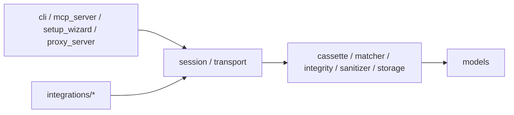

# Architecture

Rerunner enforces strict inward dependency boundaries via `import-linter` (`lint-imports`) so core data models, integrity, matching, redaction, and storage remain decoupled from transports, integrations, CLI, and MCP interfaces.

For the full module-boundary diagram, see [architecture/architecture.mermaid](architecture/architecture.mermaid).

