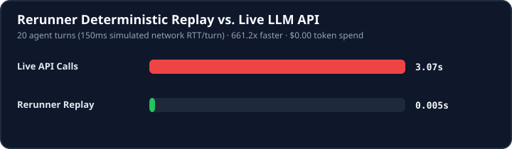
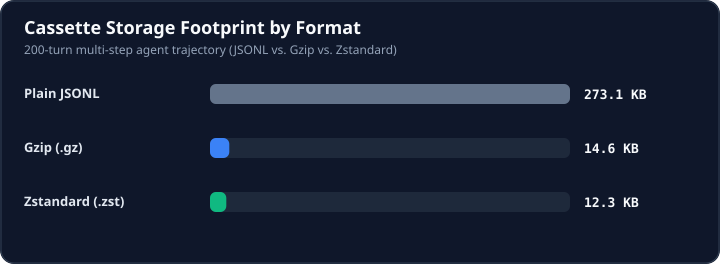

# Benchmarks

All numbers below are generated reproducibly by running:

```bash
python benchmarks/generate_report.py
```

## 1. Deterministic Replay vs. Live LLM API Latency



| Metric | Live API (`20` turns @ `150ms` RTT) | Rerunner Replay |
| :--- | :--- | :--- |
| **Total Wall Time** | 3.07s | **0.005s** |
| **Speedup** | 1.0x | **661.2x faster** |
| **Tokens Consumed** | 20,600 tokens | **0 tokens** |
| **Estimated Cost (gpt-4o)** | $0.0785 | **$0.0000** |

## 2. Cassette Serialization & Compression (200 Turns)



| Format | Extension | File Size | Space Saved | Write Time | Read Time |
| :--- | :--- | :--- | :--- | :--- | :--- |
| Plain JSONL | `cassette.jsonl` | 273.09 KB | 0.0% | 3.10 ms | 26.61 ms |
| Gzip (.gz) | `cassette.jsonl.gz` | 14.65 KB | 94.6% | 5.64 ms | 18.71 ms |
| Zstandard (.zst) | `cassette.jsonl.zst` | 12.33 KB | 95.5% | 4.94 ms | 15.28 ms |
