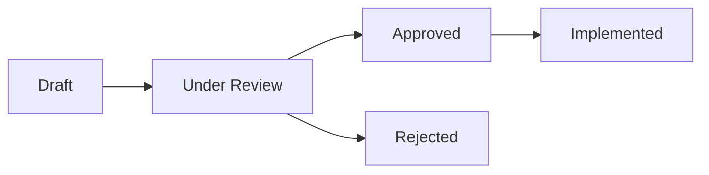

# 🏛️ Rerunner Enterprise RFC Process

Welcome to the **Rerunner RFC (Request for Comments)** directory. 

Major architectural proposals, storage protocol changes, enterprise security extensions, and new ecosystem integrations must go through our RFC process before implementation. This ensures architectural rigor, backward compatibility, and alignment with enterprise engineering standards (e.g., Google, AWS, Microsoft, OpenAI).

---

## 🔄 The RFC Lifecycle

Every architectural proposal moves through five formal stages:

1. **`Draft`**: The proposal is being formulated and structured using [`0000-template.md`](0000-template.md).
2. **`Under Review`**: The RFC is opened as a Pull Request against the `rfcs/` directory and linked to an [RFC GitHub Discussion / Issue](../.github/ISSUE_TEMPLATE/rfc.yml). Open for community & maintainer review for a minimum of 7 days.
3. **`Approved`**: Consensus reached among core maintainers. Merged into `rfcs/` with an assigned number. Implementation can begin.
4. **`Implemented`**: The code, tests, and documentation have merged into `main` and shipped in a release.
5. **`Superseded` / `Rejected`**: Replaced by a newer architectural design or rejected due to technical constraints.

---

## 📝 RFC Index

| RFC # | Title | Author / Target MNC | Status | Target Release |
| :---: | :--- | :--- | :---: | :---: |
| **[0001](0001-cloud-remote-storage.md)** | Pluggable Cloud Remote Storage Drivers (S3, GCS, Azure) | Cloud Infrastructure (AWS / GCP) | 🟡 **Approved** | v0.2.1 |
| **[0002](0002-sse-streaming-token-replayer.md)** | Faithful Server-Sent Events (SSE) Streaming Replayer | Frontier AI (OpenAI / Anthropic) | 🟡 **Approved** | v0.2.2 |

---

## 🚀 How to Propose an RFC

1. **Fork the repository** and copy [`rfcs/0000-template.md`](0000-template.md) to `rfcs/0000-my-feature.md`.
2. **Fill out all sections** thoroughly (Motivation, Detailed Specification, Security Implications, Alternatives).
3. **Submit a Pull Request** with title `RFC: <Your Feature Name>`.
4. Maintainers and community engineers will review, provide feedback, and assign the next sequential RFC number once approved.
